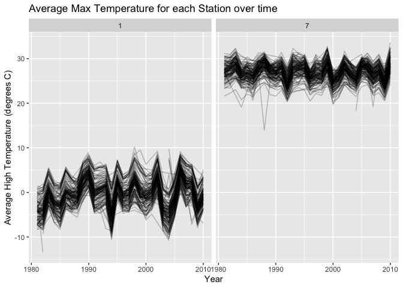
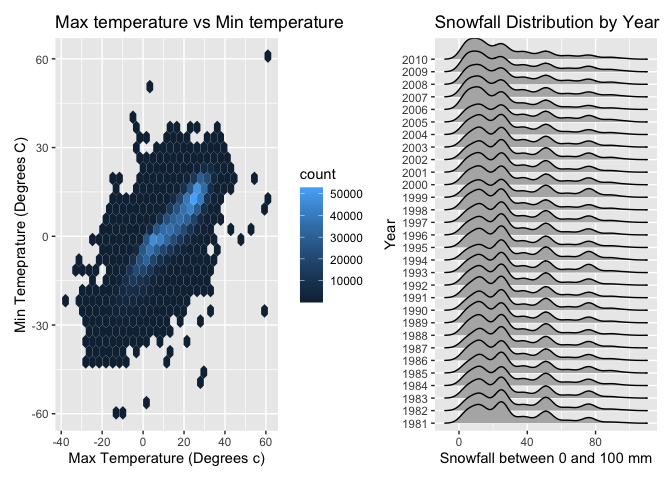
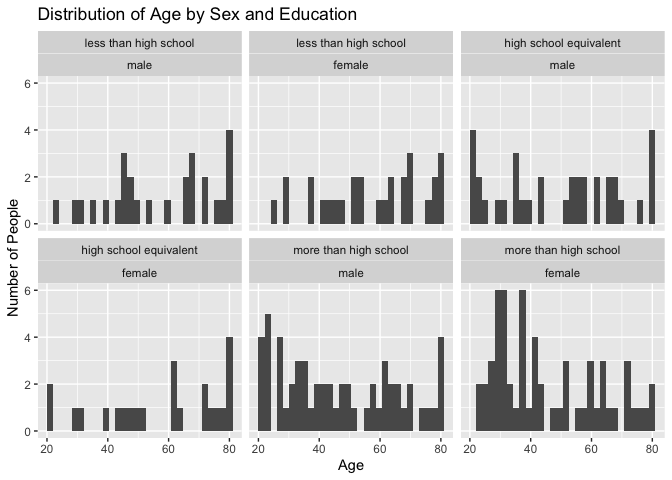
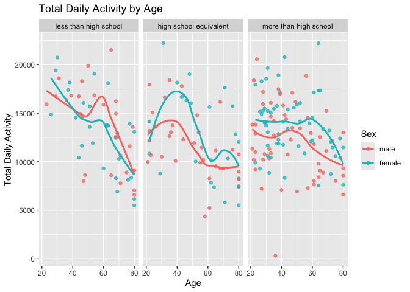
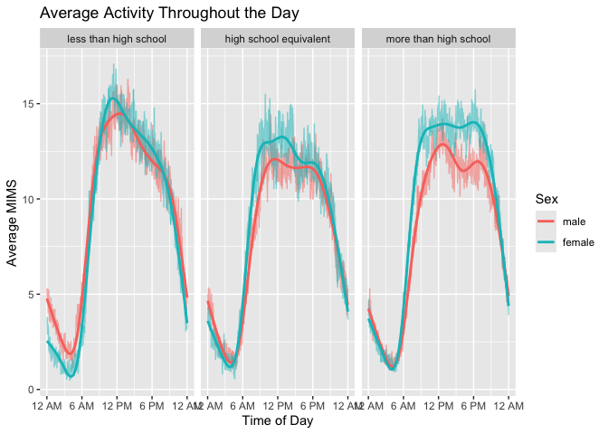

p8105_hw3_FA2818
================

# Problem 1

``` r
library(tidyverse)
```

    ## ── Attaching core tidyverse packages ──────────────────────── tidyverse 2.0.0 ──
    ## ✔ dplyr     1.2.1     ✔ readr     2.2.0
    ## ✔ forcats   1.0.1     ✔ stringr   1.6.0
    ## ✔ ggplot2   4.0.3     ✔ tibble    3.3.1
    ## ✔ lubridate 1.9.5     ✔ tidyr     1.3.2
    ## ✔ purrr     1.2.2     
    ## ── Conflicts ────────────────────────────────────────── tidyverse_conflicts() ──
    ## ✖ dplyr::filter() masks stats::filter()
    ## ✖ dplyr::lag()    masks stats::lag()
    ## ℹ Use the conflicted package (<http://conflicted.r-lib.org/>) to force all conflicts to become errors

``` r
library(p8105.datasets)
data("ny_noaa")
```

``` r
summary(ny_noaa)
```

    ##          id               date                 prcp         
    ##  Length   :2595176   Min.   :1981-01-01   Min.   :    0.00  
    ##  N.unique :    747   1st Qu.:1988-11-29   1st Qu.:    0.00  
    ##  N.blank  :      0   Median :1997-01-21   Median :    0.00  
    ##  Min.nchar:     11   Mean   :1997-01-01   Mean   :   29.82  
    ##  Max.nchar:     11   3rd Qu.:2005-09-01   3rd Qu.:   23.00  
    ##                      Max.   :2010-12-31   Max.   :22860.00  
    ##                                           NAs    :145838    
    ##       snow                snwd                tmax                tmin        
    ##  Min.   :  -13.000   Min.   :   0.00   Length   :2595176   Length   :2595176  
    ##  1st Qu.:    0.000   1st Qu.:   0.00   N.unique :    532   N.unique :    548  
    ##  Median :    0.000   Median :   0.00   N.blank  :      0   N.blank  :      0  
    ##  Mean   :    4.987   Mean   :  37.31   Min.nchar:      1   Min.nchar:      1  
    ##  3rd Qu.:    0.000   3rd Qu.:   0.00   Max.nchar:      4   Max.nchar:      4  
    ##  Max.   :10160.000   Max.   :9195.00   NAs      :1134358   NAs      :1134420  
    ##  NAs    :381221      NAs    :591786

This dataset has 2595176 and rows and 7 columns. Each row represents one
measurement of New York weather from one weather station. Columns
include `id`, identifying which weather station the measurement came
from, `date`, the date of measurement in year-month-day form, `prcp`
represents precipitation in tenths of mm, `snow` represents snowfall in
mm, `snwd` represent snow depth in mm, `tmax` and `tmin` give the max
and minimum temperature respectively, measured in tenths of degree C.
Missing data is extensive, with `pcrp`, `snow`, and `snowd` having
somewhere between 100,000 and 600,000 NA values each, and `tmax` and
`tmin` both having 1,134,358 NA values each.

``` r
ny_noaa = ny_noaa |> 
  mutate(
    year = lubridate::year(date),
    month = lubridate::month(date),
    day = lubridate::day(date)
  )
```

Since snowfall and snow depth are in mm, while precipitation is in
tenths of mm, I changed the precipitation to be in mm. Also since the
both temperature variables are char variables in tenths of degrees C, I
converted them into numeric variables in degrees C.

``` r
ny_noaa = ny_noaa |> 
  mutate(
    prcp = prcp / 10,
    tmax = as.numeric(tmax) / 10,
    tmin = as.numeric(tmin) / 10
  )
```

``` r
ny_noaa |>  count(snow, sort = TRUE)
```

    ## # A tibble: 282 × 2
    ##     snow       n
    ##    <int>   <int>
    ##  1     0 2008508
    ##  2    NA  381221
    ##  3    25   31022
    ##  4    13   23095
    ##  5    51   18274
    ##  6    76   10173
    ##  7     8    9962
    ##  8     5    9748
    ##  9    38    9197
    ## 10     3    8790
    ## # ℹ 272 more rows

Most common value for `snow` is 0 mm, which has 2,008,508 observations.
This makes sense since snow in New York is generally limited to winter,
so the majority of days throughout the year will not see snow. The
second most common value is NA, with 381,221 values. This could be due
to faulty equipment, or that some stations do not measure snowfall.

``` r
ny_noaa |> 
  filter(month == 1 | month == 7) |> 
  group_by(year, month, id) |> 
  summarize(
    tmax_mean = mean(tmax, na.rm=TRUE)
  ) |> 
  filter(!is.na(tmax_mean)) |> 
  ggplot(aes(x = year, y=tmax_mean, group=id)) + 
  geom_line(alpha = 0.25) +
  facet_grid(. ~ month) +
  labs(title = "Average Max Temperature for each Station over time",
       x = "Year",
       y= "Average High Temperature (degrees C)"
         )
```

    ## `summarise()` has regrouped the output.
    ## ℹ Summaries were computed grouped by year, month, and id.
    ## ℹ Output is grouped by year and month.
    ## ℹ Use `summarise(.groups = "drop_last")` to silence this message.
    ## ℹ Use `summarise(.by = c(year, month, id))` for per-operation grouping
    ##   (`?dplyr::dplyr_by`) instead.

<!-- -->

We see that average temperature is lower in January than July, as
expected. There is also no clear trend in temperature from 1980 to 2010
for either months. We see that from year to year, the average
temperature fluctuates, but, with the exceptions of several outliers,
all stations move in the same direction. The range of temperature across
all stations is also consistent from year to year, with a rougly 10
degrees Celsius difference between the station with the highest and
lowest average temperature. The most noticable outlier was around 1987,
when one station saw recorded an average temperature in July of 14
degrees Celsius, with no other stations close to this value.

``` r
tmax_tmin_hex = ny_noaa |> 
  filter(!is.na(tmax) & !is.na(tmin)) |> 
  ggplot(aes(x=tmax, y=tmin)) +
  geom_hex() + 
  labs(
    title = "Max temperature vs Min temperature", 
    x = "Max Temperature (Degrees c)",
    y = "Min Temeprature (Degrees C)"
  )

library(ggridges)
snowfall_ridge = ny_noaa |> 
  filter(snow > 0 & snow < 100) |> 
  ggplot(aes(x = snow, y=factor(year))) +
  geom_density_ridges() + 
  labs(
    title = "Snowfall Distribution by Year", 
    x = "Snowfall between 0 and 100 mm",
    y = "Year"
  )
  
library(patchwork)
tmax_tmin_hex + snowfall_ridge
```

    ## Picking joint bandwidth of 3.76

<!-- -->

## Problem 2

``` r
covar = read_csv("data/nhanes_covar.csv", skip = 4)
```

    ## Rows: 250 Columns: 5
    ## ── Column specification ────────────────────────────────────────────────────────
    ## Delimiter: ","
    ## dbl (5): SEQN, sex, age, BMI, education
    ## 
    ## ℹ Use `spec()` to retrieve the full column specification for this data.
    ## ℹ Specify the column types or set `show_col_types = FALSE` to quiet this message.

``` r
accel = read_csv("data/nhanes_accel.csv")
```

    ## Rows: 250 Columns: 1441
    ## ── Column specification ────────────────────────────────────────────────────────
    ## Delimiter: ","
    ## dbl (1441): SEQN, min1, min2, min3, min4, min5, min6, min7, min8, min9, min1...
    ## 
    ## ℹ Use `spec()` to retrieve the full column specification for this data.
    ## ℹ Specify the column types or set `show_col_types = FALSE` to quiet this message.

Cleaning Acceleration data Converting sex 1 and 2 to male and female and
education 123 to less than high school, high school equivalent, and more
than high school

``` r
covar = covar |> 
  mutate(
    sex = factor(
      sex,
      levels = c(1,2),
      labels = c("male", "female")
    ),
    education = factor(
      education,
      levels = c(1,2,3),
      labels = c("less than high school", "high school equivalent", "more than high school"),
      ordered = TRUE
    ) 
  )
```

Get requirements and join with accel

``` r
covar = covar |>
  filter(age >= 21) |> 
    drop_na()
nhanes = left_join(covar, accel, by = "SEQN")
```

Using inline r, tail(names(nhanes)) shows the last column names, since
names() truncates pivot longer for accel so instead of a bunch of min_x
rows, you have a min column with entries x and mims with accel values

``` r
nhanes_tidy = pivot_longer(
  nhanes,
  min1:min1440,
  names_to = "minute",
  names_prefix = "min",
  values_to = "MIMS"
) |> 
  mutate(minute = as.integer(minute))
```

Making first table

``` r
nhanes |> 
  group_by(sex, education) |> 
  summarize(
    count = n()
  ) |> 
  pivot_wider(
    names_from = sex,
    values_from = count
  ) |> 
    knitr::kable()
```

    ## `summarise()` has regrouped the output.
    ## ℹ Summaries were computed grouped by sex and education.
    ## ℹ Output is grouped by sex.
    ## ℹ Use `summarise(.groups = "drop_last")` to silence this message.
    ## ℹ Use `summarise(.by = c(sex, education))` for per-operation grouping
    ##   (`?dplyr::dplyr_by`) instead.

| education              | male | female |
|:-----------------------|-----:|-------:|
| less than high school  |   27 |     28 |
| high school equivalent |   35 |     23 |
| more than high school  |   56 |     59 |

``` r
nhanes |> 
  ggplot(aes(x = age)) +
  geom_histogram() +
  facet_wrap(education ~sex) +   
  labs(
    title = "Distribution of Age by Sex and Education",
    x = "Age",
    y = "Number of People"
  )
```

    ## `stat_bin()` using `bins = 30`. Pick better value `binwidth`.

<!-- -->
The age distributions are generally uniform across sex and education
groups, although there are more participants with greater than a high
school education. This group also seems to skew younger, with a larger
proportion of participants at younger ages.

``` r
nhanes_total = nhanes_tidy |> 
  group_by(SEQN, age, sex, education) |> 
  summarize(
    total_activity = sum(MIMS, na.rm = TRUE)
    )
```

    ## `summarise()` has regrouped the output.
    ## ℹ Summaries were computed grouped by SEQN, age, sex, and education.
    ## ℹ Output is grouped by SEQN, age, and sex.
    ## ℹ Use `summarise(.groups = "drop_last")` to silence this message.
    ## ℹ Use `summarise(.by = c(SEQN, age, sex, education))` for per-operation
    ##   grouping (`?dplyr::dplyr_by`) instead.

``` r
nhanes_total |> 
  ggplot(aes(x = age, y = total_activity, color = sex)) +
  geom_point(alpha = 0.75) +
  geom_smooth(se = FALSE) +
  facet_wrap(~education) +
  labs(
    title = "Total Daily Activity by Age",
    x = "Age",
    y = "Total Daily Activity",
    color = "Sex"
  )
```

    ## `geom_smooth()` using method = 'loess' and formula = 'y ~ x'

<!-- --> In
general, total daily activity decreases with age. Among participants
with less than a high school education, this decline is the sharpest,
although there is an uptick around ages 50–60 for men and a smaller
corresponding increase for women. However, given the relatively small
sample size, these fluctuations could be due to outliers. For those with
a high school equivalent education, activity peaks around age 40 for
both sexes, decreases until approximately age 60, and then levels off.
Among participants with more than a high school education, activity
remains relatively stable from ages 20–60 before declining at older
ages. Women generally have higher total activity than men in the high
school equivalent and more than high school groups.

``` r
nhanes_time = nhanes_tidy |> 
  group_by(education, sex, minute) |> 
  summarize(
    mean_MIMS = mean(MIMS, na.rm = TRUE),
  )
```

    ## `summarise()` has regrouped the output.
    ## ℹ Summaries were computed grouped by education, sex, and minute.
    ## ℹ Output is grouped by education and sex.
    ## ℹ Use `summarise(.groups = "drop_last")` to silence this message.
    ## ℹ Use `summarise(.by = c(education, sex, minute))` for per-operation grouping
    ##   (`?dplyr::dplyr_by`) instead.

``` r
nhanes_time |> 
  ggplot(aes(x = minute, y = mean_MIMS, color = sex)) +
  geom_line(alpha = 0.5) +
  geom_smooth(se = FALSE) +
  facet_wrap(. ~education) +
  scale_x_continuous(
    breaks = c(0, 360, 720, 1080, 1440),
    labels = c("12 AM", "6 AM", "12 PM", "6 PM", "12 AM")
  ) +
  labs(
    title = "Average Activity Throughout the Day",
    x = "Time of Day",
    y = "Average MIMS",
    color = "Sex"
  )
```

    ## `geom_smooth()` using method = 'gam' and formula = 'y ~ s(x, bs = "cs")'

<!-- -->
Across all three education levels, the general pattern is similar.
Activity is lowest during the night, reaching its minimum around 4 AM,
before increasing rapidly between 6 AM and noon. Activity generally
peaks around noon, remains relatively high until 6 PM, and then steadily
declines throughout the evening. The high school equivalent and more
than high school groups show similar patterns, with activity remaining
fairly constant between noon and 6 PM. In contrast, the less than high
school group reaches a higher peak around noon, followed by a more
gradual decline throughout the afternoon and a sharper decrease after 6
PM.
